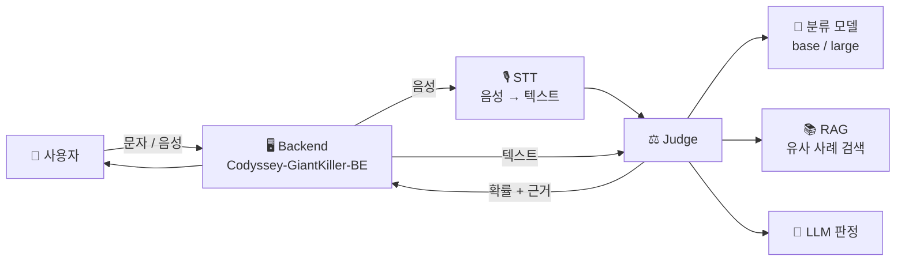

<div align="center">

# 🛡️ GiantKiller

**AI로 스미싱 문자와 보이스피싱 통화를 잡아내는 사기 탐지 서비스**

*Codyssey Hackathon 2026*


</div>

---

## 📌 소개

"엄마 나 폰 고장나서 친구 폰으로 연락해", "고객님 계정이 해외 IP에서 로그인되었습니다"

매일 쏟아지는 사기 문자와 전화, 이제는 보는 순간 판단하기 어려울 만큼 정교해졌습니다.
**GiantKiller**는 문자나 통화 내용을 넣으면 **사기일 확률**과 **판단 근거**를 알려 줍니다.

## ✨ 주요 기능

| | 기능 | 설명 |
|---|---|---|
| 💬 | **스미싱 문자 탐지** | 한국어 문자 1.6만 건으로 학습한 분류 모델이 사기 여부와 확률을 판단합니다 |
| 📞 | **보이스피싱 통화 탐지** | 통화 음성을 텍스트로 변환(STT)한 뒤 사기 패턴을 분석합니다 |
| 🔎 | **근거 제시 (RAG)** | 실제 사기 사례 중 가장 비슷한 것을 찾아 "왜 사기인지" 설명합니다 |
| 🧠 | **LLM 판정** | 분류 모델과 LLM 판단을 함께 사용해 정확도를 높입니다 |

## 🏗️ 시스템 구조



## 📂 저장소 구조

```
26codyssey_hackerton/
├── smishing/                    # 🤖 AI 탐지 엔진
│   ├── judge/                   #   판정 로직
│   │   ├── judge.py             #     기본 판정
│   │   ├── judge_rag.py         #     RAG 기반 판정 (유사 사례 근거)
│   │   ├── cody_api.py          #     LLM API 연동
│   │   ├── build_unified.py     #     데이터셋 통합
│   │   └── samples/             #     테스트용 샘플 (문자 / 음성)
│   └── model/                   #   모델 학습 · 평가
│       ├── bench_stt.py         #     STT 성능 벤치마크
│       ├── eval_voice.py        #     보이스피싱 평가
│       └── out/                 #     평가 지표 · RAG 사례 데이터
│
└── Codyssey-GiantKiller-BE/     # 🖥️ 백엔드 서버
```

## 📊 데이터

| 구분 | 규모 | 출처 |
|---|---|---|
| 💬 문자 (통합) | **15,966건** | Korean_message, KR-MOB-SMISHING v1 · v2 |
| 📞 보이스피싱 통화 | **204건** | 금융감독원 공개 보이스피싱 사례 등 |

- 여러 데이터셋을 `text` · `label` · `source` · `channel` 형식으로 하나로 통합했습니다 (`label`: 1 = 사기, 0 = 정상)
- 학습 / 검증 / 테스트 세트로 나누고, 학습에 쓰지 않은 **외부 테스트셋**으로 추가 검증했습니다
- 원본 데이터와 모델 가중치는 용량 및 라이선스 문제로 **저장소에 포함하지 않았습니다**

## 🤖 모델 성능

| 모델 | Accuracy | F1 | 비고 |
|---|---|---|---|
| base | - | - | `metrics_base.json` |
| base v2 | - | - | `metrics_base_v2.json` |
| large | - | - | `metrics_large.json` |
| large v2 | - | - | `metrics_large_v2.json` |

> 📝 수치는 `smishing/model/out/metrics_*.json` 참고

## 🚀 시작하기

```bash
# 1. 저장소 받기
git clone https://github.com/jha21vvv/26codyssey_hackerton.git
cd 26codyssey_hackerton/smishing

# 2. 가상환경 & 패키지 설치
python3 -m venv .venv && source .venv/bin/activate
pip install -r requirements.txt

# 3. 환경 변수 설정 (API 키는 절대 커밋하지 마세요!)
echo "CODY_CLAUDE_KEY=발급받은_키" > judge/.env

# 4. 샘플 문자로 판정해 보기
python judge/judge.py judge/samples/sms_scam.txt
```

## 👥 팀

| 이름 | 역할 |
|---|---|
| 안재현 | 팀장 · 인프라 |
| 나현 | 데이터 · 모델 |
| - | 백엔드 |
| - | - |

## 🔧 저장소 운영 메모

- 이 저장소는 개발 서버(NAVER Cloud GPU)에서 **5분마다 자동으로 동기화**됩니다
- `smishing/`, `Codyssey-GiantKiller-BE/` 폴더는 **GitHub 웹에서 직접 수정하지 마세요** (서버 내용으로 덮어써집니다)
- `.env`, 데이터, 모델 가중치는 자동으로 업로드에서 제외됩니다

---

<div align="center">

**Made with ☕ at Codyssey Hackathon 2026**

</div>
