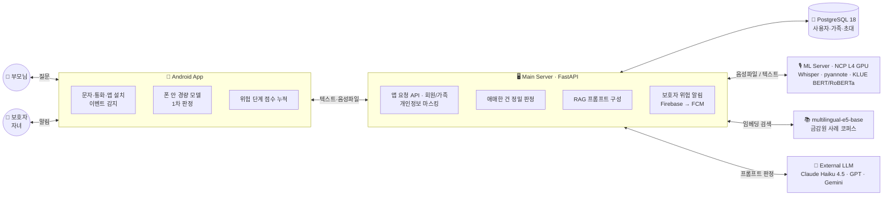

<div align="center">

# 🐱 머꼬 MEOKKO

### "이거 뭐야?" 묻기만 하면 되는 AI 가족 보안

부모님 폰에 온 수상한 문자·전화를 AI가 대신 확인하고,<br/>
위험하면 **멀리 사는 자녀에게 바로 연결**합니다.

<br/>


**Codyssey AI Hackathon 2026 · TEAM 자이언트킬러**

</div>

---

## 📌 왜 만들었나 — 물어볼 사람이 없다

<table>
<tr>
<td width="50%" valign="top">

### 📈 +278%
**2021년 대비 70대 이상 피해 비중**

`3.6%` (2021) → `13.6%` (2026.1~8)

전체 보이스피싱은 줄었지만,<br/>
**고령층 피해 비중은 두 배 이상** 늘었습니다.

<sub>자료: 경찰청 · 국민의힘 서명옥 의원실 (연합뉴스, 2026.09.22)</sub>

</td>
<td width="50%" valign="top">

### 👵 부모님
**수상한 문자, 물어볼 사람이 없다**<br/>
자녀·기관 사칭 문자는 진짜와 구분이 어렵고,<br/>
혼자 있을 때 바로 물어볼 가족이 없다

### 🧑‍💼 자녀
**피해가 생긴 뒤에야 늦게 안다**<br/>
떨어져 살아 문자가 온 순간을 모르고,<br/>
송금·앱 설치가 끝난 뒤에야 알게 된다

</td>
</tr>
</table>

## ⚔️ 차별점 — 흐름 전체를 본다

> **기존 서비스는 통화 한 통을, 머꼬는 사기 흐름 전체를 본다**

| | 기존 통신사 서비스 | 🐱 **머꼬** |
|---|---|---|
| **판단 범위** | 통화 한 통씩 판단 | **문자 → 통화 → 앱 설치** 흐름 추적 |
| **사용 조건** | 특정 통신사 가입자만 | **통신사 무관**, 앱 하나로 누구나 |
| **가족 연결** | ❌ | **진짜 자녀에게 바로 확인** — 자녀 사칭 문자가 오면 등록된 진짜 자녀에게 알림 |

## 👨‍👩‍👧 목표 사용자 — 부모님과 자녀, 함께 쓴다

| 🧓 **부모님 (60대+)** — 보호받는 사람 | 👩 **자녀 (멀리 사는 30~40대)** — 지켜주는 사람 |
|---|---|
| 작은 글씨·색 구분이 어렵다 | 떨어져 살아 바로 못 돕는다 |
| 수상한 문자, 물어볼 사람이 없다 | 피해 사실을 늦게 안다 |
| *박영수(72) · 부산에서 혼자 산다.<br/>"엄마 폰 고장났어" 문자에 앱 설치를 누를 뻔했다* | *박지현(38) · 서울 직장인, 회의 중 전화를 못 받는다.<br/>부모님이 송금한 뒤에야 사기를 알았다* |

## ✨ 주요 기능 — 묻기만 하세요

| | 기능 | 설명 |
|:---:|---|---|
| 🔔 | **알림 자동 확인** | 문자 알림을 자동으로 감지하고 폰 안의 경량 모델이 1차 판정 |
| 👨‍👧 | **자녀 사칭 즉시 확인** | "엄마 폰 고장났어" 같은 문자가 오면 등록된 **진짜 자녀**에게 "이 문자 직접 보냈나요?" 확인 요청 |
| 🎙️ | **통화 녹음 분석** | 통화 음성을 텍스트로 변환하고 화자를 분리해 검찰·기관 사칭 등 사기 패턴 탐지 |
| 🛑 | **원격제어 앱 설치 멈춤** | 의심 통화 뒤 원격제어 앱 설치가 감지되면 "이 앱을 열지 마세요" 경고 + 자녀에게 긴급 알림 |
| 🎨 | **유니버설 컬러 UI** | 🟢 안심 · 🟡 주의 · 🔴 위험 — 고령자(수정체 황변)와 색약자 모두 구별되는 **CUD 색 조합** |

## 🎬 시나리오 — 한 번에 끝나지 않는다

사기는 **문자 → 전화 → 앱 설치**로 이어집니다. 머꼬는 **단계마다 막고**, 단계가 진행될수록 위험도가 올라갑니다.

```
① 사칭 문자 도착  →  ② 머꼬 경고  →  ③ 자녀에게 확인  →  ④ 사기 전화 감지  →  ⑤ 앱 설치 차단
     🟢 낮음            🟢 관심           🟡 주의             🟠 경고              🔴 위험
```

## 🏗️ 시스템 구성



**판정 흐름**: ① 폰 1차 판정 → ② 애매하면 서버로 → ③ STT · 임베딩 검색 → ④ 프롬프트 LLM 판정 → ⑤ 위험 단계 누적 시 보호자 알림

## 🛠️ 기술 스택

| 영역 | 기술 | 구분 |
|---|---|---|
| 📱 **App** | Android · Kotlin · AGP 9.0.1 · 폰 안 경량 모델 | 직접 개발 · 직접 학습 |
| 🖥️ **Server** | FastAPI · Python 3.14 · SQLAlchemy async · Alembic · fastapi-users | 직접 개발 · 오픈소스 |
| 🐘 **DB** | PostgreSQL 18 (Docker) | 오픈소스 |
| ☁️ **Infra** | NCP L4 23GB GPU 서버 · Docker Compose · Cloudflare Tunnel · FCM | 외부 인프라 |
| 🎙️ **STT** | faster-whisper large-v3 fp16 · pyannote 화자 분리 · 개인정보 마스킹 | 직접 구축 · 오픈소스 모델 |
| 🤖 **분류기** | KLUE BERT · RoBERTa (base / large) | 직접 학습 |
| 📚 **RAG** | multilingual-e5-base · JSONL 사례 코퍼스 (유사 사기/정상 사례 검색) | 직접 개발 · 오픈소스 모델 |
| 🧠 **LLM** | Claude Haiku 4.5 (코디세이 AI 게이트웨이) · GPT · Gemini 백업 | 외부 API |

## 📂 저장소 구조

```
26codyssey_hackerton/
├── smishing/                    # 🤖 AI 탐지 엔진 (NCP GPU 서버)
│   ├── judge/                   #   판정 로직
│   │   ├── judge.py             #     분류 모델 판정
│   │   ├── judge_rag.py         #     RAG + LLM 판정 (유사 사례 근거)
│   │   ├── cody_api.py          #     코디세이 AI 게이트웨이 연동
│   │   ├── build_unified.py     #     데이터셋 통합
│   │   └── samples/             #     테스트 샘플 (문자 / 통화 음성)
│   └── model/                   #   모델 학습 · 평가
│       ├── bench_stt.py         #     STT 벤치마크
│       ├── eval_voice.py        #     통화 사기 판정 평가
│       └── out/                 #     평가 지표 · RAG 사례 데이터
│
└── Codyssey-GiantKiller-BE/     # 🖥️ 백엔드 (FastAPI · PostgreSQL)
```

> Android 앱 소스는 별도로 관리됩니다.

## 📊 데이터

| 구분 | 규모 | 출처 |
|---|---|---|
| 💬 스미싱 문자 (통합) | **15,966건** | meal-bbang/Korean_message · KR-MOB-SMISHING v1 · v2 |
| 📞 보이스피싱 통화 | **204건** | 금융감독원 공개 보이스피싱 사례 · KsponSpeech |

- 여러 데이터셋을 `text` · `label` · `source` · `channel` 형식으로 통합 (`label`: 1 = 사기, 0 = 정상)
- 학습 / 검증 / 테스트 분리 + 학습에 쓰지 않은 **외부 테스트셋**으로 추가 검증
- 원본 데이터 · 모델 가중치는 용량 및 라이선스 문제로 **저장소에 포함하지 않습니다**

## 👥 TEAM 자이언트킬러

| | 이름 | 역할 | 담당 |
|:---:|---|---|---|
| 👑 | **안재현** | 팀장 · 안드로이드 | 역할 분담 · 일정 조율 · 안드로이드 앱 개발 · 앱 화면/기능 통합 |
| 📱 | **이나현** | 안드로이드 | 안드로이드 앱 제작 · NCP L4 GPU에 Whisper 구동 · 데이터 수집 · BERT/RoBERTa 분류기 · e5 RAG 판정 |
| 🤖 | **신연서** | AI | AI 개발 · 사기 판정 모델 학습/검증 · AI 판정 결과 백엔드 연동 |
| 🖥️ | **양승조** | AI · 백엔드 | FastAPI 서버 · 회원/가족 초대 API · DB · 문자·통화 → AI 판정 → 자녀 앱 전달 |
| 🎨 | **박경내** | 기획 · 발표 · 디자인 | 기획 · 발표 · PPT · 시연 영상 · 앱 화면 디자인 |

## 🚀 확장 가능성 — 가족에서 기업 · 공공으로

| **B2C** 👨‍👩‍👧 가족 구독 | **B2B** 🏦 은행 · 통신사 | **B2G** 🏛️ 지자체 |
|---|---|---|
| 가족 단위 요금제 | 송금 전 위험 경고 연계 | 독거 어르신 돌봄 연계 |
| 부모님 폰 + 자녀 앱 연동 | 스미싱 · 스팸 필터 연동 | 장애인 · 다문화 가정 등 취약층 |
| 통신사 무관, 앱 하나로 설치 | 신고 데이터로 RAG 사례 확대 | 공공 신고 데이터와 연계 |

## 📜 오픈소스 · 외부 자원

| 구분 | 명칭 | 용도 | 라이선스 |
|---|---|---|---|
| 오픈소스 | FastAPI · Uvicorn · Pydantic · HTTPX · python-dotenv · python-multipart | 백엔드 · AI 서버 | MIT · BSD-3-Clause · Apache-2.0 |
| 오픈소스 | PyTorch · Hugging Face Transformers · faster-whisper | 분류 모델 학습/추론 · 통화 받아쓰기 | BSD-3-Clause · Apache-2.0 · MIT |
| 오픈소스 | Android Gradle Plugin 9.0.1 · JUnit 4.13.2 | 안드로이드 빌드 · 테스트 | Apache-2.0 · EPL-1.0 |
| 모델 | OpenAI Whisper large-v3 · klue/bert-base | 음성 인식 · 분류기 베이스 | MIT · CC-BY-SA-4.0 |
| 데이터 | meal-bbang/Korean_message · KR-MOB-SMISHING v1 | 스미싱 분류 학습/평가 | 표기 없음 · CC BY-NC 4.0 |
| 외부 API | Claude (코디세이 게이트웨이) · Google Gemini · OpenAI 호환 API | 문자 · 통화 사기 분석 LLM | 각 제공사 약관 |
| 인프라 | NCP GPU 서버 (gpl4-g3) | 받아쓰기 · 분류 모델 학습/추론 | NCP 이용약관 |

---

<details>
<summary>🔧 저장소 운영 메모 (팀 내부용)</summary>

- 이 저장소는 개발 서버(NCP GPU)에서 **5분마다 자동 동기화**됩니다
- `smishing/`, `Codyssey-GiantKiller-BE/` 폴더는 **GitHub 웹에서 직접 수정하지 마세요** — 서버 내용으로 덮어써집니다
- `.env`(API 키), 데이터, 모델 가중치는 업로드에서 자동 제외됩니다
- 루트의 이 README는 웹에서 수정해도 괜찮습니다

</details>

<div align="center">

<br/>

**🐱 혼자서도 안심 — 부모님은 안심, 자녀는 실시간 알림으로 안심**

<sub>Made with ☕ by TEAM 자이언트킬러 · Codyssey AI Hackathon 2026</sub>

</div>


<div align="center">

**Made with ☕ at Codyssey Hackathon 2026**

</div>
